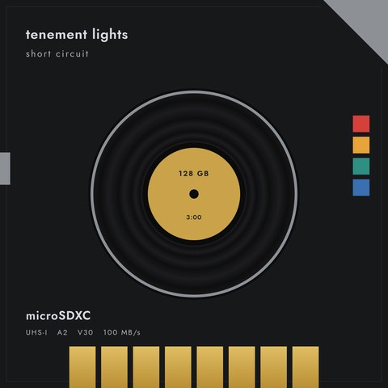
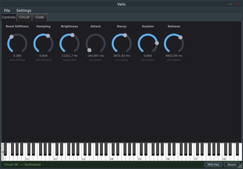
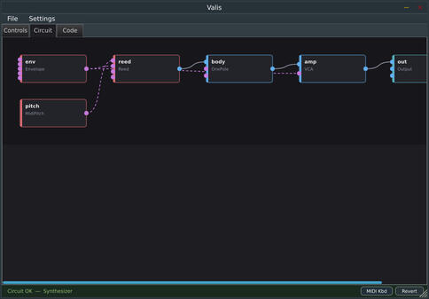
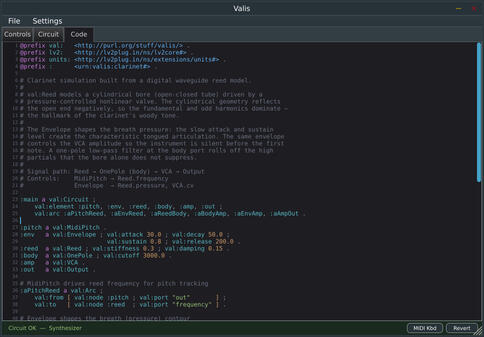
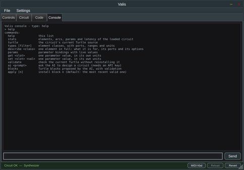

# Valis

[](https://www.youtube.com/watch?v=AeckJOo5350)

*Tenement Lights: an original instrumental made with Valis. [How it was made](docs/new-order-track.md).*

**Virtual Analog LLM Integrated System** ([video demo](https://www.youtube.com/watch?v=iwrzSXKTRcY))

Valis is a standalone app and a DAW plugin for building virtual analog instruments and effects. You describe a circuit
in [RDF](https://en.wikipedia.org/wiki/Resource_Description_Framework) (Turtle syntax), and Valis plays it.

| Controls | Circuit | Code | Console |
|----------|---------|------|---------|
| [](docs/images/controls.jpeg) | [](docs/images/circuit.jpeg) | [](docs/images/code.jpeg) | [](docs/images/console.jpeg) |

The same circuit has four views:

- **Controls**: knobs, switches and meters, styled after Cold War test equipment (Dark or Light under Settings, Theme).
- **Circuit**: a graph of components and the arcs between them.
- **Code**: a Turtle editor with syntax highlighting.
- **Console**: a terminal into the loaded circuit, with an AI circuit designer.

Everything the UI can do is also available over MCP, so an LLM can design, build, render and measure circuits. The
[guide for agents](docs/guide-for-agents.md) explains how. The element classes are declared in the Valis ontology,
[`vocabs/valis.ttl`](vocabs/valis.ttl).

To browse what's already here, see the [circuit catalogue](https://danja.github.io/valis/catalogue.html) and the
[element catalogue](https://danja.github.io/valis/element-catalogue.html). Finished pieces made with Valis are in
[valis-artifacts](https://github.com/danja/valis-artifacts).

## Virtual analog, briefly

[Virtual analog](https://en.wikipedia.org/wiki/Analog_modeling_synthesizer) means simulating electronic circuits in code
instead of writing the DSP directly. Vadim Zavalishin's
[The Art of VA Filter Design](reference/VAFilterDesign_1.0.3.pdf) is the key reference, and covers a lot more than
filters. Valis models circuits as connected functional blocks, not as individual components the way
[SPICE](https://en.wikipedia.org/wiki/SPICE) does. Where it earns its keep it goes finer: `val:Diode` is a Shockley-equation
junction (a 1N4148 by default), `val:DiodePair` is an antiparallel soft clipper, and `val:Triode` is a Koren-style valve stage.

## A circuit is a Turtle file

A circuit is a set of elements and explicitly named arcs between their ports. Element classes, port symbols and control
ranges reuse the [LV2](https://en.wikipedia.org/wiki/LV2) vocabulary.

```turtle
@prefix val:   <http://purl.org/stuff/valis/> .
@prefix lv2:   <http://lv2plug.in/ns/lv2core#> .
@prefix units: <http://lv2plug.in/ns/extensions/units#> .
@prefix :      <urn:valis:circuit#> .

:main a val:Circuit ; val:element :osc , :vcf , :drive , :out ;
      val:arc :a1 , :a2 , :a3 .

:osc   a val:Oscillator ; val:frequency 440.0 ; val:shape 1.0 .   # 1 = saw
:vcf   a val:Ladder ; val:cutoff 800.0 ; val:resonance 0.7 .
:drive a val:DiodePair ; val:seriesResistance 2200.0 .
:out   a val:Output .

:a1 a val:Arc ; val:from [ val:node :osc   ; val:port "out" ] ;
                val:to   [ val:node :vcf   ; val:port "in"  ] .
:a2 a val:Arc ; val:from [ val:node :vcf   ; val:port "out" ] ;
                val:to   [ val:node :drive ; val:port "in"  ] .
:a3 a val:Arc ; val:from [ val:node :drive ; val:port "out" ] ;
                val:to   [ val:node :out   ; val:port "in"  ] .

# Bind host parameter slot 0 to the filter's cutoff.
:p0 a val:Param ; val:slot 0 ; val:target :vcf ; val:property val:cutoff ;
    lv2:name "Cutoff" ; lv2:symbol "cutoff" ; units:unit units:hz .
```

The ontology is loaded at runtime, not just documented. A test checks that its class set and the DSP registry's factory set
match in both directions, so a class with no implementation (or the reverse) fails the build. The vocabularies it builds
on are vendored beside it: [`vocabs/lv2/`](vocabs/lv2) (LV2 1.18.10) and [`vocabs/w3c/`](vocabs/w3c) (rdf, rdfs, owl).

## How it fits together

Four layers, with two hard boundaries. Every operation is one `Op`, and the three views and the MCP server are thin adapters
over that one surface, never a second implementation. Below the model is the real-time line: the audio callback never
allocates, never does I/O and never parses RDF. A `CompiledCircuit` is built and fully preallocated on the message thread,
then handed to the engine by an atomic pointer swap.

```
  ┌─ ui/ ──────────────────────┐   ┌─ mcp/ ───────┐
  │  Code  │ Circuit │ Controls│   │ HTTP/JSON-RPC│
  └───────────┬────────────────┘   └──────┬───────┘
              └────────┬──────────────────┘
                  ┌────▼─────┐   ops/ - the headless command surface.
                  │   Ops    │   Every key operation is one Op. UI and MCP
                  └────┬─────┘   are both thin adapters over it.
   ═══════════════════ │ ═══════════════ message thread only ═══════════
                  ┌────▼─────┐
                  │  Model   │   rdf/ · model/ · compiler/
                  └────┬─────┘   Turtle → CircuitModel → CompiledCircuit
   ═══════════════════ │ ═══════════════ RT boundary ═════════════════
                  ┌────▼─────┐
                  │  Engine  │   engine/ · dsp/
                  └──────────┘   Preallocated.
```

`valis_core` links `juce_dsp` and serd/sord only, with no GUI module, so the model, compiler and DSP layers are testable as
plain console executables.

## What works

All the milestones in [`docs/plan.md`](docs/plan.md) are done. Standalone, VST3 and LV2 build by default, and CLAP is opt-in.

- Errors name the element or arc at fault, and parse errors carry a line and column.
- The engine allocates nothing on the audio thread. A test counts allocations through an overridden `operator new`. Output
  doesn't depend on the host's buffer size: rendering at 128 and 512 samples is bit-identical.
- The MCP server exposes the same operations as the UI. Inserting an element over MCP redraws the graph while the audio keeps
  running.
- `valis-render` renders a circuit headless, with no host, GUI or audio device. It synthesises a transport from `--tempo` and
  `--rolling`, so a tempo-locked circuit renders offline as it plays.
- The host transport reaches the circuit (tempo and position in quarter notes), and note events are sample-accurate.
- The Controls view draws each control by the shape of its port: a two-position switch for a toggle or a two-way enumeration, a
  selector strip for a longer enumeration, and a dial for everything else.

The element set is large (98 classes) and includes oscillators, filters, saturation, dynamics, modulation and reverb, plus physical
models: plucked and bowed strings, a flute and clarinet built on a shared waveguide, modal bars and membranes, and a granulator.
[`docs/examples.md`](docs/examples.md) lists the shipped circuits. The case studies for the
[flute](docs/manual/flute.md), [clarinet](docs/manual/clarinet.md) and [granulator](docs/manual/granular.md) show measured results.
There's also an [original instrumental](docs/new-order-track.md) played by instruments modelled on a 1983 electronic record, and
[`docs/making-a-track.md`](docs/making-a-track.md) walks through making a track from circuits to Reaper.

One rough edge: structural edits in the graph view re-serialise the document, so hand formatting and comments are lost. It warns
you the first time.

## Building

```sh
./build.sh
```

That builds the Release plugin and tools in `build-release/`, with the neural ears of `valis-shot` included. The first configure
downloads ONNX Runtime, and the models are fetched separately (see [`docs/shot.md`](docs/shot.md)). Set `VALIS_WITH_ONNX=0` to
leave them out, and `JOBS` to change the parallelism.

Tests are opt-in, because the full Debug suite takes about five minutes:

```sh
VALIS_TESTS=quick ./build.sh   # Debug build and tests without the slow one, then Release
VALIS_TESTS=1 ./build.sh       # every test, then Release
ctest --test-dir build --output-on-failure   # run the tests alone
```

Then launch the standalone app. It prefers the Release build and falls back to Debug:

```sh
./valis
```

You need CMake 3.22 or newer, a C and C++20 compiler (JUCE won't configure without a C compiler) and
[JUCE 9.0.1](https://github.com/juce-framework/JUCE), which `VALIS_JUCE_DIR` points at (default `~/github/JUCE`):

```sh
git clone --depth 1 --branch 9.0.1 https://github.com/juce-framework/JUCE ~/github/JUCE
```

serd and sord are fetched and built for you unless serd 0.32.0 or newer is installed. Older versions have a different `SerdError`
layout that crashes in the error callback. The Debian and Ubuntu packages and the plugin format checks are in
[`docs/manual/building.md`](docs/manual/building.md).

To configure by hand, for example a tests-only core with no plugin targets:

```sh
cmake -S . -B build -G Ninja -DCMAKE_BUILD_TYPE=Debug \
  -DVALIS_BUILD_TESTS=ON -DVALIS_BUILD_PLUGIN=OFF -DVALIS_WITH_MCP=ON -DVALIS_JUCE_DIR=$HOME/github/JUCE
cmake --build build --parallel "$(nproc)"
```

The CMake options are `VALIS_BUILD_TESTS` (ON), `VALIS_BUILD_PLUGIN` (ON), `VALIS_WITH_MCP` (ON), `VALIS_WITH_NAM` (ON, Neural Amp
Modeler support, fetched if `VALIS_NAM_DIR` has no checkout), `VALIS_WITH_FREESOUND` (ON), `VALIS_WITH_ONNX` (OFF) and
`VALIS_WITH_CLAP` (OFF; build it with `VALIS_WITH_CLAP=1 ./build.sh`).

## Using it from an agent

Turn on the MCP server under **Settings, MCP Server** in the plugin. It binds to loopback only. To check it's up:

```sh
curl -s localhost:7676/mcp -d '{"jsonrpc":"2.0","id":1,"method":"tools/list"}'
```

`VALIS_MCP_PORT` (default 7676) and `VALIS_MCP_TOKEN` (default none) set the port and bearer token at startup. Several instances in
one host take the next free port. See [`docs/manual/mcp.md`](docs/manual/mcp.md).

`docs/manual/elements.md` is generated from the ontology, so it can't drift from what the plugin offers. Regenerate it with
`./scripts/generate-docs.sh`. The two catalogue pages are generated too, by `scripts/catalogue.py`.

## Checking a sound without ears

`valis-shot` measures a rendered sound for a caller that can't hear it. `measure` reports loudness (LUFS, loudness range, true peak),
attack and decay times and the spectrum, and `compare` gives the distance in dB between two renders. `listen`, built with
`-DVALIS_WITH_ONNX=ON`, runs two neural models locally through [ONNX Runtime](https://onnxruntime.ai) to label a sound and score how
well sentences describe it. It's a work in progress: the interfaces and output will change, and nothing is calibrated against
listening yet. See [`docs/shot.md`](docs/shot.md).

The ideas come from [earshot](https://github.com/Leonxlnx/earshot) by Leon Lin (MIT licence), which `src/shot/` ports to C++. The
models are CLAP by [LAION](https://github.com/LAION-AI/CLAP) and the
[Audio Spectrogram Transformer](https://arxiv.org/abs/2104.01778) by Gong, Chung and Glass. Their weights aren't in this
repository. `scripts/shot/fetch-models.sh` downloads them when you ask.

## Licence

Anything that involves JUCE is [AGPL](https://www.gnu.org/licenses/agpl-3.0.en.html), see [`LICENSE`](LICENSE). JUCE 9 is
AGPLv3-or-commercial, so a distributed binary that links JUCE under the AGPL must be AGPL as a whole. The `.ttl` and other
descriptive files stand apart from that and are MIT licensed. Derivative works that don't use the JUCE components may be considered
under the MIT licence.
